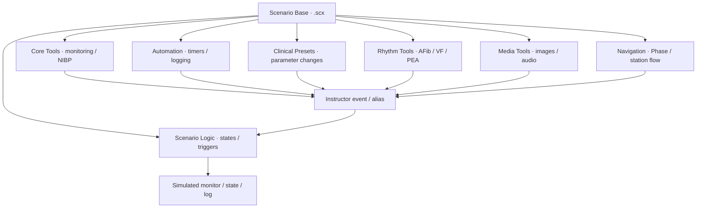
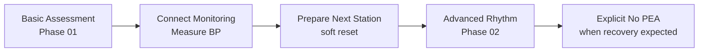

# MedSim Toolkit — Architectural Blueprint

Version: **0.2 · 2026-11-16**  
Status: proposal + website prototype; no new native SimDesigner resources were generated or validated by this project.

## Goal

Make common simulation operations simpler and more reliable for a medical instructor by replacing repeated multi-step control sequences with predictable, reusable event-driven building blocks. Keep the medical scenario itself separated from operational utilities.

## System map

## Modules and boundaries

| Area | Proposed native file | Responsibility | Out of scope |
|---|---|---|---|
| Core Tools | `CORE_Monitoring.hnx` | One-click BP measurement, attach/detach monitoring | Direct management of PEA/rhythm |
| Core Session | `CORE_Session.hnx` | Small standard instructor actions | Entire scenario state |
| Automation | `AUT_Timers.hnx` | Timers, counters, milestones, instructor messages | Unverified infinite loops |
| Clinical Presets | `CLIN_Presets.hnx` | Hyperkalemia / configurable vital targets / Trends | Unreviewed patient-care logic |
| Rhythm Tools | `RHY_Rhythms.hnx` | AFib, VF, PEA / PEA exit guard / Pacing where available | Monitor-only reset |
| Media | `MEDIA_Presentation.hnx` | Audio playback, images, presentation modes | Claim that Hidden stops sound |
| Navigation | `NAV_Phase_Control.hnx` | Restart, phase transition, soft station reset | Claim that Phase = separate scenario |
| Scenario Logic | `BASE_Training_Station.scx` (+ `.phx` event groups) | Patient states, link triggers, handler start/stop | Universal handler with every scenario embedded |

**Core vs clinical separation:** `CORE_NIBP_MEASURE` changes device mode to provoke a measurement; it is not a clinical BP rise/fall preset. `RHY_PEA_OFF` changes a simulated physiologic flag and must be explicitly set when leaving a PEA state.

## Event naming standard

- Internal ID: `DOMAIN_SUBJECT_ACTION`, uppercase ASCII. Examples: `CORE_NIBP_MEASURE`, `MEDIA_PLAY_CRY`, `NAV_STATION_SOFT_RESET`.
- Instructor Alias: short verb-first string, such as **Measure BP**, **Connect Monitoring**, **Prepare Next Station**, **Exit PEA**.
- One group per practical concern. Alias and internal ID are related but not identical; verify preservation when reusing a Handler.
- Keep a version and dependency manifest beside each native template.

## Scenario Base v0.1 — teaching station

### Operational reset process (proposed)

1. Stop/re-scope old handlers and trends that must not continue.
2. Register **Remove NIBP**, **Remove 3-lead ECG**, **Remove Pulse Oximeter** events for the simulated monitor.
3. Apply **Silence / Pause Alarms** according to the teaching intention and check whether the pause expires.
4. Close or stop media using a method confirmed for the target monitor; never rely on `Hidden` to stop audio.
5. Reset required timers/counters and specify the new patient state explicitly.
6. Use a state link to enter the destination Phase. Verify real result in LLEAP.

Three distinct operations must not be conflated: **Reset Monitoring**, **Station Soft Reset**, **Scenario Restart**. Phase transitions do not inherently create a new run/session.

### PEA exit guard

When arriving from a state in which PEA is enabled, and the intended destination is perfusing rhythm:

1. Explicitly choose `No PEA` / PEA Off at destination, **not** `No change`.
2. Set intended ECG rhythm, pulse, vital parameters, and state dependencies independently.
3. Verify monitor and physical simulated pulse, then test a second possible transition route.
4. This is a simulator configuration safety check, not medical treatment advice.

This pitfall is user-reported. The SimDesigner Help reference identifies an ECG PEA parameter, but exact state inheritance is version-dependent and must be tested.

## Pattern quality gates

| State | Meaning | Evidence needed |
|---|---|---|
| Proposed | Designed only | Description + trigger/response sketch |
| Documented capability | Manual describes primitive | Manual version + feature location |
| Reported working | Author has used it | Recorded context, not universal proof |
| Tested locally | Passed on target system | Software + simulator model, exact steps, test log |
| Reusable | Re-imported successfully | Second scenario load, dependency check |
| Released | Approved for instructor use | Local clinical/operational review + rollback copy |

## Roadmap

- **M1 — Reusable Core:** save `CORE_Monitoring.hnx` with NIBP and Attach All. Test repeated activation and importing it into a second scenario.
- **M2 — Station flow:** implement and test Detach All, alarms, media-stop behavior, soft-reset, and navigation.
- **M3 — Physiologic consistency:** create Rhythm tools, PEA Guard, sample clinical preset with expert review.
- **M4 — Advanced parameterization:** evaluate UDV/expressions for relative/fixed changes and verify `.hnx` dependencies.
- **M5 — Instructor impact:** measure baseline clicks, elapsed time, errors, repetitions, and task completion for one-instructor and previous workflows.

## Operational improvement measurement

For a repeated action, record: baseline operator clicks per cycle, automated clicks per cycle, number of cycles per run, number of runs, action duration, error rate, and number of operators required per station. Then:

`avoided_clicks = (baseline_clicks - automated_clicks) × cycles × runs`

The user's initial 1–5 button presses avoided per cycle are **an estimate**, not a verified study. Reductions in confusion and the feasibility of one-instructor operations need their own testing. Do not describe one person per station as an actual staff reduction until the operating model is measured and approved.

### Attribution

Record who identified the problem, who suggested an underlying system capability, who combined it into a mechanism, and who verified/refined it. For the NIBP case: operational problem and automation implementation arose from the user's work; a colleague demonstrated event capability in a Trend, which helped unlock the approach. Preserve credit accurately.