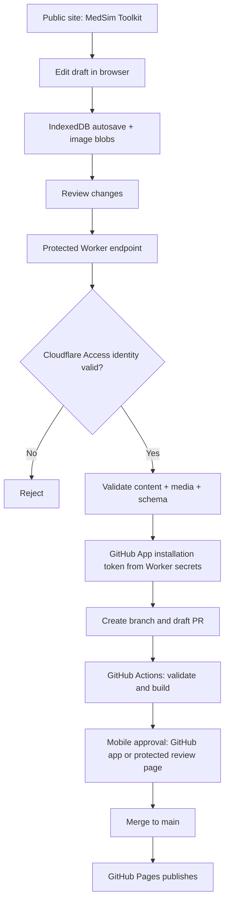

# Publishing design: no GitHub sign-in required on the work PC

## Proposed verified flow (NOT implemented)

The Worker must **never** accept an arbitrary repository, branch, executable source path, or workflow identifier from the client. Accept only structured content schema, whitelisted image types and safe fixed paths. Bind the GitHub App to the chosen repository with minimum read/write permissions. The client receives an opaque draft ID and review URL, not GitHub credentials. Limit file sizes and scan/inspect image attachments where organization policy requires it. Keep an immutable audit trail of actor/date/change SHA.

## Alternate bridge without server

The owner can export the zipped `content/knowledge.json` and `assets` in the work browser, transfer them through an approved route, and commit from a personal device. This is **not** automatic and must comply with workplace data-handling policy.

## Approval details

A protected `review` page can show changed titles, diffs and screenshot thumbnails and call an authenticated Worker `POST /approve`. That endpoint should only merge one immutable, validated PR SHA. It must reject stale build checks and any PR changed since preview. Use 2FA/passkeys on the owner identity. If the GitHub mobile app is accessible, direct PR approval there is simpler than building a custom review system.

## Repository recommendation

`main` is deployable, and content changes are proposed on `content/<timestamp>-<opaque id>` branches with draft PRs. Require at least the appropriate CI check, no secrets, and manual approval. For a solo repository, establish a documented review gate; approvals from the same author may not satisfy strict branch-protection reviewer rules, so the owner can approve via a protected custom workflow or explicit merge after checks.